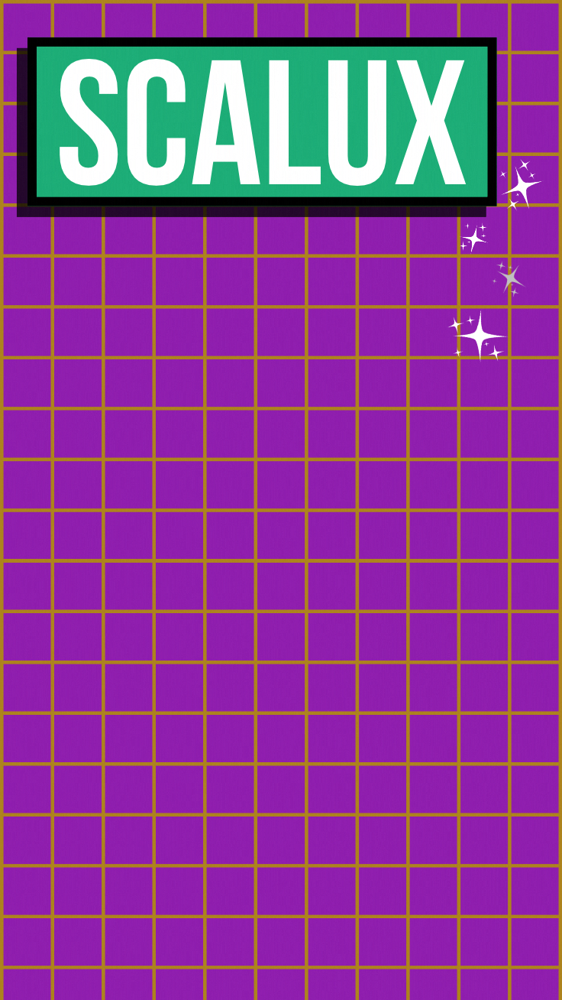

<table>
    <tr>
        <!-- Ajuste da largura da célula -->
        <td style="width: 40%;">
            <!-- Ajuste da largura da imagem -->
            
        </td>
        <td style="width: 60%; vertical-align: middle;">
            

                
        Scalux
    

                                                                                                                            

<a href="https://ausollet-dev.itch.io/ultra-entropia">Ultra Entropia ☆ !</a>
     
about me ☆ 

    
    │▸ 𝚑𝚎/𝚑𝚒𝚖 - 𝚋𝚛𝚊𝚣𝚒𝚕𝚒𝚊𝚗 - (𝚙𝚝/𝚋𝚛 + 𝚎𝚗𝚐𝚕𝚒𝚜𝚑)
        ┗ ▸ game developer - currently working on ULTRA ENTROPIA                                             
    │▸ improving on
        ┗ ▸  GDScript
